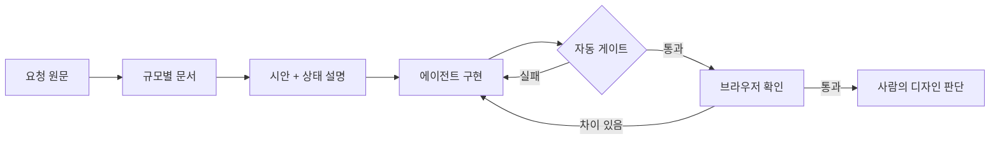

# 🎨 Frontend-agent

**AI 에이전트 실험 결과를 프론트엔드에 어떻게 적용할까**

온톨로지 · 감독관 · 하네스 실험에서 나온 결과를 프론트엔드 작업 방식으로 옮겼습니다.

---

## 📌 한눈에 보기

| 실험 결과 | 프론트엔드 적용 |
|---|---|
| 규칙이 없으면 짐작한다 | 화면 상태와 문구를 문서로 |
| 문서는 지시해야 읽는다 | 상태 설명과 지도를 함께 지정 |
| 문서보다 검사가 정확하다 | 토큰 · 상태 · 흐름을 테스트로 |
| 비싼 구성이 늘 낫지 않다 | 에이전트 하나로 시작 |

> 작은 화면 하나로 먼저 확인했습니다. 더 큰 규모의 적용은 아직 가설입니다.

---

## 📊 프론트엔드에서 확인한 것

시트 화면 하나와 상태 4개를 웹으로 구현하게 하고, 숨은 테스트 25개로 채점했습니다.

| 에이전트에게 준 것 | 정답률 | 3회 모두 통과 | 화면 차이 | 비용 |
|---|---:|---:|---:|---:|
| 🖼️ 시안 이미지만 | 70.7% | 60% | 15.37% | $0.114 |
| 📝 + 상태 설명 · 지도 | 92.0% | 80% | 12.38% | $0.135 |
| 🚦 + 자동 게이트 | 94.7% | 84% | 11.70% | $0.145 |
| 🌐 + 브라우저 확인 | 97.3% | 96% | 12.47% | $0.162 |

- 화면 차이는 시안과 다른 픽셀 비율이고, 낮을수록 좋습니다
- 모델은 Sonnet 5.5, 조건마다 3회 실행했습니다

### 그래서 이렇게 적용합니다

- **상태 설명은 꼭 함께 주기**
  - 비용 약 $0.02로 정답률이 21.3%p 올랐습니다
  - 이미지만 준 3회 모두 오프라인 · 중복 이름 규칙을 놓쳤습니다
- **게이트 · 브라우저 확인은 작은 화면에서 선택**
  - 더 올랐지만 평균 1문항도 안 되는 차이입니다
- **화면 일치는 사람이 확인하기**
  - 비교 도구를 줘도 화면 차이가 줄지 않았습니다
- **접근성은 따로 검사하기**
  - 12회 모두 색 대비 위반이 남았습니다

### 한계

- 화면 하나를 3회씩 잰 결과라 조건 사이의 작은 차이는 우연일 수 있습니다
- 게이트의 동작 테스트가 3개뿐이라 효과가 작게 나왔을 수 있습니다
- 첫 시도가 기록 없이 끝난 2회는 다시 돌렸습니다
- 전체 결과: [experiments/frontend/results/2026-11-02-small.md](experiments/frontend/results/2026-11-02-small.md)

---

## 🧪 실험에서 나온 것과 적용법

### 📚 온톨로지 실험

[코딩 실험](https://github.com/kyungchan3007/ontology-coding-bench) · [챗봇 실험](https://github.com/kyungchan3007/ontology-sql-bench)

- **결과**
  - 지식 없는 코딩 정답률 44~47% → 문서를 주면 100%
  - 스키마만 준 DB 질문 67% → 규칙 문서 97~100%
  - 온톨로지와 스펙의 차이는 작음
- **프론트엔드 적용**
  - 빈 · 로딩 · 오류 · 권한 화면을 시안과 문서에 적기
  - 오류 문구는 글자까지 정해 두기
  - 정하지 않은 값은 미정으로 표시하기

### 🧑‍⚖️ 감독관 · 서브에이전트 실험

[advisor-bench](https://github.com/kyungchan3007/advisor-bench)

- **결과**
  - 감독관을 붙이면 쉬운 과제 비용이 6~8배
  - 어려운 과제도 Sonnet 혼자 전부 정답, Opus 혼자의 약 1/10 비용
  - 서브에이전트는 맡길 일을 적어야 움직임
- **프론트엔드 적용**
  - 화면 구현은 에이전트 하나로 시작하기
  - 감독관은 기본으로 끄기
  - 위임할 때는 읽을 시안과 범위를 적기

### 🚦 하네스 실험

[harness-lab](https://github.com/kyungchan3007/Harness)

- **결과**
  - 규칙을 문서에서 검사로 옮기면 93.7% → 99.1%
  - "이 문서를 읽어라" 링크는 26번 중 0번 읽힘
  - 요구를 원문으로 넘기면 46% → 100%
- **프론트엔드 적용**
  - 토큰 밖 색상 값은 린트로 막기
  - 상태별 화면은 테스트로 확인하기
  - 디자이너와 기획의 요청은 요약 없이 넘기기

---

## 🧭 프론트엔드 작업 흐름

---

## 📐 규모별 문서에 담을 것

기본은 하네스이고, 규모에 따라 문서를 더합니다.

| 규모 | 문서 | 프론트엔드에서 담을 것 |
|---|---|---|
| 🐣 소형 | SDD · 엔티티 | 컴포넌트 설계, API 타입 |
| 🐥 중형 | 온톨로지 추가 | 역할 × 상태 × 화면 규칙 |
| 🐔 대형 | PRD 추가 | 사용자 시나리오, 제외 범위 |

- 엔티티는 API 스키마에서 생성한 타입을 원본으로
- 같은 사실은 한 문서에만

---

## 🚦 프론트엔드 게이트

| 단계 | 잡는 것 | 판정 |
|---|---|---|
| 타입 · 린트 | 계약 위반, 토큰 이탈 | 자동 |
| 컴포넌트 테스트 | 상태별 화면 | 자동 |
| E2E | 핵심 사용자 흐름 | 자동 |
| 접근성 검사 | 라벨, 키보드 조작 | 자동 |
| 시각 비교 | 레이아웃 차이 | 자동 + 사람 |
| 디자인 판단 | 위계, 사용감 | 사람 |

작은 프로젝트는 위쪽 단계만 둬도 됩니다.

---

MIT License

