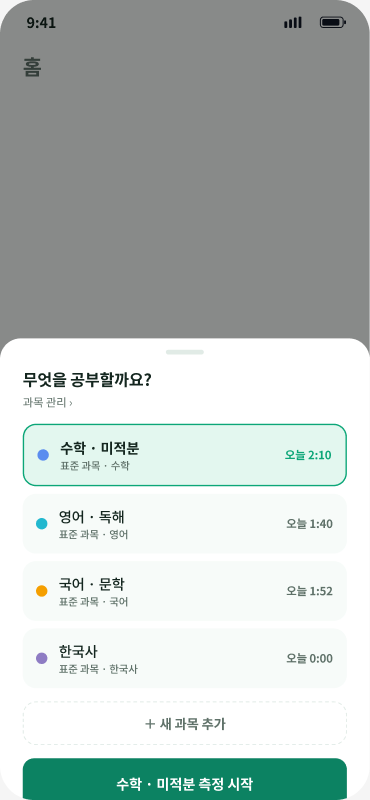
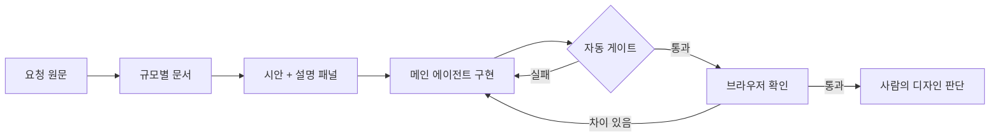
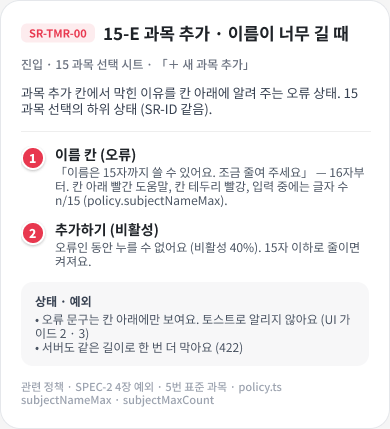

# 🎨 frontend-agent-bench

**세 번의 실험으로 프론트엔드를 위한 에이전트 디자인을 만들어 봤습니다**

이제 실제 앱 시안으로, 이 디자인이 정말 화면을 좋아지게 하는지 검증합니다.

첫 과제로 쓸 공부반장의 과목 선택 시안

---

## 📌 한눈에 보기

- **출발점**: 온톨로지 · 감독관 · 하네스 실험에서 배운 것
- **결과물**: 프론트엔드용 에이전트 디자인
- **검증**: 공부반장 Figma 시안을 구현하고 숨은 테스트로 채점
- **상태**: 설계 단계이며 아직 측정 결과는 없음

---

## 🧪 세 가지 실험에서 배운 것

| 실험 | 확인한 것 | 저장소 |
|---|---|---|
| 📚 온톨로지 | 문서 형식보다 규칙의 유무 | [코딩](https://github.com/kyungchan3007/ontology-coding-bench) · [챗봇](https://github.com/kyungchan3007/ontology-sql-bench) |
| 🧑‍⚖️ 감독관 · 서브에이전트 | 비싼 구성이 늘 낫지는 않음 | [advisor-bench](https://github.com/kyungchan3007/advisor-bench) |
| 🚦 하네스 | 문서보다 실행되는 검사 | [harness-template](https://github.com/kyungchan3007/harness-template) |

### 📚 온톨로지
- 지식 없이 코딩 정답률 44~47% → 문서를 주면 100%
- DB 질문은 스키마만 67% → 규칙 문서 97~100%
- 온톨로지와 스펙의 차이는 작음

### 🧑‍⚖️ 감독관 · 서브에이전트
- 감독관을 붙이자 쉬운 과제 비용이 6~8배로 늘어남
- 어려운 과제도 Sonnet 혼자 전부 정답, Opus 혼자의 약 1/10 비용
- 서브에이전트는 맡길 일을 요청에 적어야 움직임

### 🚦 하네스
- 규칙을 문서에서 검사로 옮기자 93.7% → 99.1%
- AGENTS.md의 "이 문서를 읽어라" 링크는 26번 중 0번 읽힘
- 요구를 요약하지 않고 원문으로 넘기자 46% → 100%

---

## 🧭 그래서 만든 에이전트 디자인

### 원칙

| 원칙 | 프론트엔드 적용 |
|---|---|
| 짐작할 자리를 없앤다 | 빈 · 오류 · 권한별 화면 규칙 |
| 읽으라고 지시한다 | 위임마다 읽을 문서 명시 |
| 완료는 게이트가 판정한다 | 테스트 + 브라우저 검증 |
| 싼 구성부터 시작한다 | 메인 에이전트 하나 |

### 규모별 문서

모든 규모의 기본은 하네스입니다.

| 규모 | 문서 구성 |
|---|---|
| 🐣 소형 | SDD · 엔티티 |
| 🐥 중형 | 온톨로지 · SDD · 엔티티 |
| 🐔 대형 | 온톨로지 · PRD · SDD · 엔티티 |

> 이 디자인의 프론트엔드 적용은 아직 가설입니다. 세 실험 모두 화면 품질을 재지 않았기 때문입니다.

---

## 🔬 이번 실험

**같은 시안과 문서를 줄 때, 무엇을 더해야 결과가 좋아지는가?**

### 과제: 공부반장

중 · 고등학생을 위한 공부 시간 측정 앱의 실제 Figma 시안을 씁니다.

| 규모 | 구현 범위 |
|---|---|
| 소형 | 과목 선택 시트 + 상태 4장 |
| 중형 | 공부 측정 흐름 |
| 대형 | 측정 + 그룹 + 선생님 |

 
시안의 설명 패널에 적힌 상태와 문구가 채점 기준이 됩니다

### 비교 조건

| 조건 | 시안 전달 | 자동 게이트 | 브라우저 확인 |
|---|---:|---:|---:|
| A | 이미지만 | ❌ | ❌ |
| B | 이미지 + 패널 + 지도 | ❌ | ❌ |
| C (하네스 기본) | 이미지 + 패널 + 지도 | ✅ | ❌ |
| D | 이미지 + 패널 + 지도 | ✅ | ✅ |

- 과제 3개 × 조건 4개 × 3회 = **36회**
- 전체 설계: [experiments/frontend/design.md](experiments/frontend/design.md)

### 채점

| 항목 | 방법 |
|---|---|
| 🖱️ 동작 | 숨은 Playwright 테스트 |
| 🖼️ 화면 | 시안 이미지와 픽셀 비교 |
| 📏 규칙 | 토큰 · 터치 영역 · 접근성 |
| 🔁 안정성 | 3회 모두 통과한 비율 |
| 💸 비용 | 비용 · 시간 · 턴 |

### 한계
- 실행 환경이 웹이라 네이티브 고유 문제는 재지 못함
- 픽셀 비교는 사용감을 판단하지 못함

---

## 🚧 진행 상황

- [x] 저장소 생성
- [x] 실험 설계
- [ ] 소형 과제 채점 규칙 확정
- [ ] 시안 사본 · 기준 구현 · 숨은 테스트
- [ ] 소형 시험 실행 · 비용 추정
- [ ] 전체 36회 실행
- [ ] 결과 정리

---

## 📊 결과

아직 없습니다. 실행이 끝나면 불리한 결과까지 그대로 올립니다.

---

## 🔗 관련 저장소

- [ontology-coding-bench](https://github.com/kyungchan3007/ontology-coding-bench): 연차휴가 모듈 코딩
- [ontology-sql-bench](https://github.com/kyungchan3007/ontology-sql-bench): 인사 DB 챗봇
- [advisor-bench](https://github.com/kyungchan3007/advisor-bench): 감독관 · 서브에이전트 비용
- [harness-template](https://github.com/kyungchan3007/harness-template): 이 저장소의 기반

MIT License

