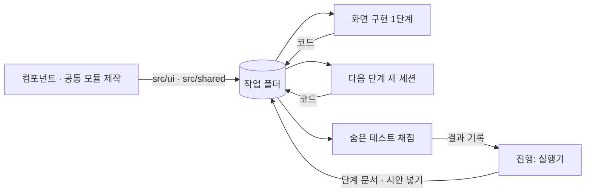

<div align="center">

# 🎨 frontend-architecture

**작은 프로젝트의 프론트엔드, 어떻게 만들어야 가장 효율적일까**

디자인 시스템 · 공통 모듈 · 아키텍처를 에이전트와 함께 만들어 보며 공부한 기록입니다.

</div>

---

## 🔎 찾고 있는 것

> 작은 프로젝트에서 디자인 시스템과 공통 모듈을 어떻게 적용해야 효과적일까?
> 프론트엔드 아키텍처는 어떻게 가져가는 게 좋을까?
> 에이전트의 도움을 받아 가장 효율적인 환경을 찾아가 보고 있습니다.

| 질문 | 비교 | 상태 |
|---|---|---|
| 🧱 디자인 시스템 | 없음 · 토큰 · 컴포넌트 · 린트 | ✅ 완료 |
| 🧰 공통 모듈 | 없음 · 미리 제공 · 에이전트 추출 | ✅ 완료 |
| 📦 코드 위치 | 앱 안(`src/ui`) · 패키지(`packages/ui`) | ✅ 완료 |
| 🏛️ 아키텍처 | 종류별 폴더 · FSD · VSA | 🔜 다음 |
| 🤖 환경 개선 | 사람이 만든 환경 · 에이전트가 고친 환경 | ⏳ 예정 |

---

## 🤖 에이전트와 함께 개발한다면: 생산성과 비용

### 공통 모듈은 언제 만들까

화면 3개를 만들고 규칙과 API 경로를 차례로 바꿨습니다. 조건마다 1번씩 돌렸습니다.

| 공통 모듈 | 정답률 | 새 화면 1개 | 전체 시간 | 실행 비용 | 준비 비용 |
|---|---:|---:|---:|---:|---:|
| 🫥 없음 | 48/49 | 42초 | 177초 | $0.487 | 없음 |
| 📦 미리 제공 | 48/49 | 32초 | 166초 | $0.480 | $0.091 |
| ✂️ 에이전트가 추출 | 48/49 | 39초 | 162초 | $0.508 | 없음 |

- 이번에는 정답률이 같았고, 미리 만들면 새 화면은 빨랐지만 준비 비용까지 더하면 가장 비쌌습니다

### 디자인 시스템을 어디까지 갖출까

화면 3개를 차례로 만들고 디자인 변경을 한 번 요청해, 숨은 테스트 53개로 채점했습니다.

| 갖춘 것 | 정답률 | 새 화면 1개 | 전체 시간 | 전체 비용 |
|---|---:|---:|---:|---:|
| 🫥 없음 | 96.2% | 32초 | 138초 | $0.394 |
| 🎨 토큰 | 98.7% | 32초 | 142초 | $0.408 |
| 🧩 + 컴포넌트 | 97.5% | 30초 | 129초 | $0.366 |
| 🚧 + 린트 | 98.1% | 34초 | 145초 | $0.423 |

- 컴포넌트 제작 비용 $0.171은 전체 비용에 넣지 않았습니다
- 컴포넌트가 가장 빨랐지만, 화면 3개로는 제작비를 돌려받지 못한 것으로 보입니다
- 린트는 게이트 실행이 4회에서 7회로 늘어 시간과 비용이 가장 컸습니다

### 무엇을 함께 줘야 할까

시트 화면 하나와 상태 4개를 웹으로 구현하게 하고, 숨은 테스트 25개로 채점했습니다.

| 에이전트에게 준 것 | 정답률 | 3회 모두 통과 | 화면 차이 | 비용 |
|---|---:|---:|---:|---:|
| 🖼️ 시안 이미지만 | 70.7% | 60% | 15.37% | $0.114 |
| 📝 + 상태 설명 · 지도 | 92.0% | 80% | 12.38% | $0.135 |
| 🚦 + 자동 게이트 | 94.7% | 84% | 11.70% | $0.145 |
| 🌐 + 브라우저 확인 | 97.3% | 96% | 12.47% | $0.162 |

- 상태 설명은 비용 약 $0.02로 정답률을 21.3%p 올렸습니다
- 게이트와 브라우저 확인의 차이는 평균 1문항도 안 돼서, 효과가 있다고 말하기는 어려웠습니다

---

## 🧑‍💻 개발자 입장에서: 편의와 유지보수

### 코드 위치: 앱 안에 둘까, 패키지로 뺄까

같은 앱을 두 구조로 놓고 비교했더니 빌드와 수정 반영 속도는 같았고, 패키지 쪽은 설정 파일만 늘었습니다.

옮기는 일은 코드를 옮기고, 화면의 가져오는 경로를 고치고, 패키지 설정을 만든 뒤 `npm install`로 연결하는 정도였습니다.

### 공통 코드는 어디에 둘까

디자인 시스템을 쓸지와 어디에 둘지는 별개의 문제라고 봤습니다. 앱이 하나라면 쓰되 굳이 따로 빼지 않아도 될 것 같습니다.

| 질문 | 지금 생각 | 그렇게 본 이유 |
|---|---|---|
| 디자인 시스템을 쓸까? | 토큰은 처음부터, 컴포넌트는 화면이 이어질 때 | 값 어긋남이 줄어듦 |
| 공통 함수를 모을까? | 두 번째 화면에서 필요할 때 모아 보기 | API 변경 파일이 3개에서 1개로 줄어듦 |
| `packages/`로 뺄까? | 앱이 하나면 안 빼도 될 듯 | 속도가 같고 설정 파일만 늘어남 |

| 종류 | 예시 | 두려는 위치 |
|---|---|---|
| 공통 컴포넌트 · 토큰 | 버튼, 칩, 색상 값 | `src/ui` · `src/tokens.css` |
| 한 화면에서만 쓰는 함수 | 그 화면 전용 계산 | 그 화면 파일 안 |
| 두 화면 이상에서 쓰는 함수 | 시간 표시, 이름 길이 검사 | `src/shared` |
| 함께 바뀌는 값 | API 경로, 최대 길이, 오류 문구 | `src/shared`에 먼저 모아 보기 |

이럴 때는 패키지로 빼는 쪽도 생각해 볼 만하다고 봤습니다.

- 웹과 관리자 화면처럼 앱이 두 개 이상일 때
- 다른 프로젝트에서도 쓸 계획이 이미 정해져 있을 때
- 공통 코드가 앱 코드를 가져다 쓰지 못하게 막고 싶을 때

옮긴다면 토큰도 함께 옮겨야 할 것 같습니다. 이번 구조에서는 토큰이 앱에 남아서 컴포넌트만 떼어 쓸 수 없었습니다. 순수 함수는 토큰과 React에 묶이지 않으니 먼저 옮기기 좋아 보입니다.

> 실험으로 비교한 것은 API 호출 · 규칙 · 문구입니다. 위치 표의 나머지와 패키지 검토 기준은 비교하지 않은 판단입니다.

### 패키지가 없으면 중복이 생기지 않을까

중복은 패키지가 없어서라기보다 기준이 되는 한 곳이 없을 때 생기는 것 같습니다. 아래는 모두 패키지 없이 비교한 결과입니다.

| 상황 | 결과 |
|---|---|
| 공통 모듈도 안내도 없음 | API 경로 10곳, 이름 문구 파일 2개 |
| 공통 모듈을 주거나 옮기라고 안내 | API 경로 1곳, 이름 문구 파일 1개 |
| 토큰 없음 → 토큰 있음 | 토큰 밖 색 23~87개 → 0개 |
| 컴포넌트 없음 → 있음 | 직접 쓴 버튼 16~18개 → 3~4개 |
| 컴포넌트 + 린트 | 직접 쓴 버튼 0개 |

- **한 곳에 두기:** `src/shared`, `src/tokens.css`
- **안내하기:** "두 화면 이상에 쓰면 옮겨라", "있는 부품을 먼저 써라"
- **검사로 막기:** 직접 쓴 색, `button`, `fetch`를 린트로 잡기

패키지가 있어도 화면에서 `fetch`를 직접 쓰거나 색을 직접 적는 것까지 막아 주지는 않을 것 같습니다. 패키지가 정말 필요한 중복은 앱이 두 개 이상일 때라고 봤습니다. 앱끼리는 `src/shared`를 함께 쓸 수 없어 복사가 생기기 때문입니다.

> 린트로 확인한 것은 색과 `button` · `input`까지입니다. `fetch` 린트와 비슷한 함수를 또 만드는 중복, 앱 두 개에서의 복사는 비교하지 않았습니다. 비슷한 함수는 린트로 잡기 어려워 코드 리뷰가 필요해 보입니다.

### 팀원이 많으면 패키지가 필요할까

기준은 팀원 수보다 공통 코드를 쓰는 앱의 수에 가깝다고 봤습니다. 실험으로 비교한 내용은 아니고 지금까지의 생각입니다.

| 상황 | 패키지 | 먼저 해 볼 일 |
|---|---:|---|
| 앱 하나, 팀원 여러 명 | 없어도 될 듯 | `src/ui` 담당자 지정, 코드 리뷰, 린트 |
| 공통 코드와 화면 담당이 나뉘고 변경이 자주 부딪힘 | 고민해 볼 만함 | 폴더 경계와 리뷰 규칙부터 시도 |
| 앱이 두 개 이상 | 필요해 보임 | 패키지로 옮겨 보기 |

- **공통 코드를 아무나 고칠 때:** `CODEOWNERS`로 리뷰 담당자를 지정해 볼 수 있습니다
- **화면이 공통 코드 안쪽을 직접 가져다 쓸 때:** 린트로 `src/ui/index.js`로만 가져오게 막아 볼 수 있습니다
- **같은 컴포넌트를 또 만들 때:** `ui.md` 문서와 리뷰로 잡아 볼 수 있습니다

한 저장소 안의 패키지는 버전을 나누지 않으면 공통 코드를 고쳤을 때 모든 화면이 바로 영향을 받습니다. 그래서 충돌이나 리뷰 문제가 저절로 줄어들지는 않을 것 같습니다.

### 공통 모듈: 고칠 때 얼마나 편한가

| 공통 모듈 | API 경로 위치 | 규칙 변경 | API 변경 |
|---|---:|---:|---:|
| 🫥 없음 | 10곳 | 2개 파일 | 3개 파일 |
| 📦 미리 제공 | 1곳 | 1개 파일 | 1개 파일 |
| ✂️ 에이전트가 추출 | 1곳 | 1개 파일 | 1개 파일 |

### 디자인 시스템: 코드가 어떻게 남는가

| 갖춘 것 | 버튼 값 어긋남 | 토큰 밖 색 | 직접 쓴 버튼 | 디자인 변경 범위 |
|---|---:|---:|---:|---:|
| 🫥 없음 | 3회 중 2회 | 23~87개 | 16~17개 | 3개 파일 |
| 🎨 토큰 | 3회 중 1회 | 0개 | 17~18개 | 4개 파일 |
| 🧩 + 컴포넌트 | 3회 중 0회 | 0개 | 3~4개 | 3~4개 파일 |
| 🚧 + 린트 | 2회 중 0회 | 0개 | 0개 | 3개 파일 |

### 그래서 다음에는 이렇게 해 보려고 합니다

- **앱이 하나면 `src/ui`로 시작해 보기**
  - 패키지로 빼도 느려지지 않지만, 앱 하나에서는 얻는 것도 보이지 않았습니다
  - 다른 앱과 함께 쓸 일이 생기면 그때 토큰까지 함께 옮겨 보려고 합니다
- **토큰은 처음부터 둬 보기**
  - 토큰 밖 색이 0개가 됐고, 비용 차이는 작았습니다
- **화면이 이어지면 컴포넌트를 더해 보기**
  - 버튼 값이 어긋나지 않았습니다
- **린트는 어긋남이 실제로 생길 때 더해 보기**
  - 직접 쓴 버튼은 0개가 됐지만 재작업이 늘었습니다
- **공통 모듈은 두 번째 화면에서 옮겨 보기**
  - 준비 비용 없이 미리 만든 것과 같은 변경 범위를 얻었습니다
  - 에이전트에게 "두 화면 이상에 쓰면 옮겨라"라고 지시했더니 스스로 옮겼습니다
- **API 경로와 규칙부터 한 곳에 모아 보기**
  - 모으지 않으면 API 변경에 파일 3개를 고쳤고, 모으면 1개였습니다
- **화면 규칙은 따로 적고 검사해 보기**
  - 측정 중의 바꾸기 버튼은 11회 중 7회 틀렸고, 컴포넌트가 있어도 나왔습니다
- **화면 일치는 사람이 확인해 보기**
  - 비교 도구를 줘도 화면 차이가 줄지 않았습니다
- **접근성은 따로 검사해 보기**
  - 색 대비 위반이 조건과 상관없이 자주 남았습니다

---

## ⚠️ 한계

- 조건마다 1~3회뿐이라 작은 차이는 우연일 수 있습니다
- 공통 모듈 실험은 조건마다 1번이고, 변경 요청도 쉬운 2개뿐입니다
- 디자인 시스템의 정답률 차이는 53문항 중 2문항 미만이라 구분되지 않습니다
- 린트 조건은 1회가 중단돼 2회입니다
- 시간은 에이전트의 작업 시간이고, 사람이 검토하는 시간은 포함하지 않았습니다
- 편의는 코드 지표로 본 것이고, 개발자가 직접 평가한 값이 아닙니다
- 코드 위치 비교는 작은 앱 하나로 한 번 비교한 값이고, 여러 앱 공유와 TypeScript 설정은 비교하지 않았습니다
- 전체 결과: [코드 위치](experiments/frontend/results/2026-11-03-pkg.md) · [공통 모듈](experiments/frontend/results/2026-11-03-module.md) · [디자인 시스템](experiments/frontend/results/2026-11-03-ds.md) · [시안 전달](experiments/frontend/results/2026-11-02-small.md)

---

## 🧪 이 프로젝트에서 사용한 에이전트 디자인

앞선 실험에서 본 결과를 가져와 에이전트 구성을 정했습니다.

### 앞선 실험에서 가져온 것

| 실험 | 그때 본 것 | 여기서 적용한 것 |
|---|---|---|
| 📚 [온톨로지](https://github.com/kyungchan3007/ontology-coding-bench) | 지식 없는 코딩은 44~47%, 문서를 주면 100% | 시안과 함께 설명 패널 · SDD · 엔티티를 전달 |
| 🧑‍⚖️ [감독관](https://github.com/kyungchan3007/advisor-bench) | 감독관을 붙이면 쉬운 과제 비용이 6~8배 | 감독관 없이 Sonnet 하나로 구현 |
| 🚦 [하네스](https://github.com/kyungchan3007/Harness) | 규칙을 검사로 옮기면 93.7% → 99.1% | 끝내기 전에 게이트를 강제 |
| 🚦 [하네스](https://github.com/kyungchan3007/Harness) | 읽으라는 링크는 26번 중 0번 읽힘 | 안내에 "먼저 읽는다"를 직접 지시 |
| 🚦 [하네스](https://github.com/kyungchan3007/Harness) | 요구를 원문으로 넘기면 46% → 100% | 요청 원문을 `request.md`에 고정 |

### 에이전트 역할

| 역할 | 모델 | 하는 일 | 실행 |
|---|---|---|---|
| 🧭 진행 | Opus 5.5 | 실험 설계, 실행기 작성, 결과 정리, PR | 이 저장소 작업 세션 |
| 🧑‍💻 화면 구현 | Sonnet 5.5 | 단계별 화면 구현과 변경 요청 처리 | 단계마다 새 세션 |
| 🧩 컴포넌트 제작 | Sonnet 5.5 | 시안의 카드를 보고 `src/ui` 작성 | 1번 |
| 🧰 공통 모듈 제작 | Sonnet 5.5 | 계약 문서를 보고 `src/shared` 작성 | 1번 |
| 📦 패키지 세팅 | Sonnet 5.5 | `packages/` 구조로 분리 | 1번 |

- 서브에이전트와 감독관은 쓰지 않았습니다. 화면 하나를 만드는 데 나눌 일이 크지 않다고 봤습니다
- 채점은 에이전트가 아니라 숨은 테스트를 돌리는 프로그램이 맡았습니다

### 에이전트끼리 어떻게 넘겼나

대화나 프롬프트로 넘기지 않고 파일로만 넘겼습니다. 다음 단계의 에이전트는 앞 단계의 대화를 모르고, 남은 코드와 문서만 봅니다.



- 뒤 단계의 화면은 미리 넣지 않아, 에이전트가 앞으로 만들 화면을 모르는 상태로 작업합니다

### 실제로 전달한 프롬프트

화면 구현 에이전트에게는 단계마다 같은 문장을 줬습니다.

```text
TASK.md의 과제를 구현하세요. 끝나면 무엇을 했는지 한 줄로 말하세요.
```

자세한 내용은 작업 폴더의 `CLAUDE.md`로 전달했습니다.

```markdown
# 작업 안내

- 과제: TASK.md
- 설계: sdd.md, entities.md
- 시안 지도: design-map.md. 구현 전에 먼저 읽고, 지도에 적힌 패널을 모두 읽는다
- 완료 전 `node tools/check.mjs`가 GATE PASS여야 한다
- 파일은 Write · Edit 도구로 쓴다. 명령은 작업 폴더에서 `node` · `npx`로 바로 실행한다
```

비교할 조건은 이 안내에 한 줄씩 더했습니다.

| 조건 | 더한 안내 |
|---|---|
| 토큰 | 색 · 모서리 값은 `src/tokens.css`의 토큰으로 쓴다 |
| 컴포넌트 | 있는 부품을 먼저 쓰고, 여러 화면에 쓸 모양은 `src/ui`에서 고친다 |
| 린트 | `node tools/lint-ui.mjs`가 통과해야 한다 |
| 공통 모듈 제공 | API 호출 · 규칙 · 문구 · 오프라인은 `src/shared`의 것을 쓴다 |
| 공통 모듈 추출 | 두 화면 이상에 쓰는 코드는 `src/shared`로 옮겨 함께 쓴다 |

한 번만 돌린 제작 에이전트에게는 할 일을 직접 줬습니다.

```text
ui-contract.md의 공통 컴포넌트를 src/ui/에 React + Tailwind로 만드세요.
모양은 components/의 카드 이미지를 모두 읽고 따르고,
색 · 모서리는 src/tokens.css의 토큰을 쓰세요. 다른 파일은 바꾸지 마세요.
다 만들면 npx vite build로 확인하고, 각 컴포넌트의 쓰는 법을 ui.md에 짧게 적으세요.
```

### 하네스 형식

작업마다 쓴 하네스와, 에이전트 실행에 쓴 하네스를 나눴습니다.

| 어디 | 무엇 | 역할 |
|---|---|---|
| 저장소 | `AGENTS.md` | 에이전트의 단일 진입점과 절대 규칙 |
| 저장소 | `.agents/specs/번호-이름/request.md` | 요청 원문 고정 |
| 저장소 | `.agents/specs/번호-이름/plan.md` | 할 일, 애매한 곳, 파일 계획, 허점 |
| 저장소 | `.agents/checks.sh` | 작업 기록 · 보호 파일 · 작업 범위 검사 |
| 저장소 | `.claude/settings.json` | 작업 폴더 밖 쓰기를 막고, 끝낼 때 게이트 실행 |
| 실험 | `TASK.md` · `sdd.md` · `entities.md` · `design-map.md` | 단계마다 바꿔 넣는 과제 문서 |
| 실험 | `tools/check.mjs` | 빌드 · 기본 동작 테스트, 린트 조건은 린트까지 |
| 실험 | `tools/stop-gate.mjs` | 끝내기 전에 게이트를 돌리고 실패하면 세 번까지 되돌림 |
| 실험 | 허용 도구 | Read · Write · Edit · Glob · Grep, `node` · `npx` · `npm` · `ls` |
| 실험 | 숨은 테스트 | 작업 폴더 밖에 두어 에이전트가 볼 수 없음 |

실제 내용: [실험 안내](experiments/frontend/bench/conditions-ds.mjs) · [실행기](experiments/frontend/bench/workdir-ds.mjs) · [과제 문서](experiments/frontend/task/ds) · [컴포넌트 계약](experiments/frontend/task/ds/ui-contract.md)

---

## 🧭 프론트엔드 작업 흐름


---

## 📐 문서에 담아 본 것

저는 하네스를 기본으로 두고, 작은 프로젝트에는 문서 두 개를 더해 보고 있습니다.

| 문서 | 프론트엔드에서 담을 것 |
|---|---|
| SDD | 컴포넌트 설계, 상태별 화면 |
| 엔티티 | API 타입 |

- 엔티티는 API 스키마에서 생성한 타입을 원본으로
- 같은 사실은 한 문서에만

---

## 🚦 생각해 둔 프론트엔드 게이트

| 단계 | 잡는 것 | 판정 |
|---|---|---|
| 타입 · 린트 | 계약 위반, 토큰 이탈 | 자동 |
| 컴포넌트 테스트 | 상태별 화면 | 자동 |
| E2E | 핵심 사용자 흐름 | 자동 |
| 접근성 검사 | 라벨, 키보드 조작 | 자동 |
| 시각 비교 | 레이아웃 차이 | 자동 + 사람 |
| 디자인 판단 | 위계, 사용감 | 사람 |

---

<div align="center">

MIT License

</div>
